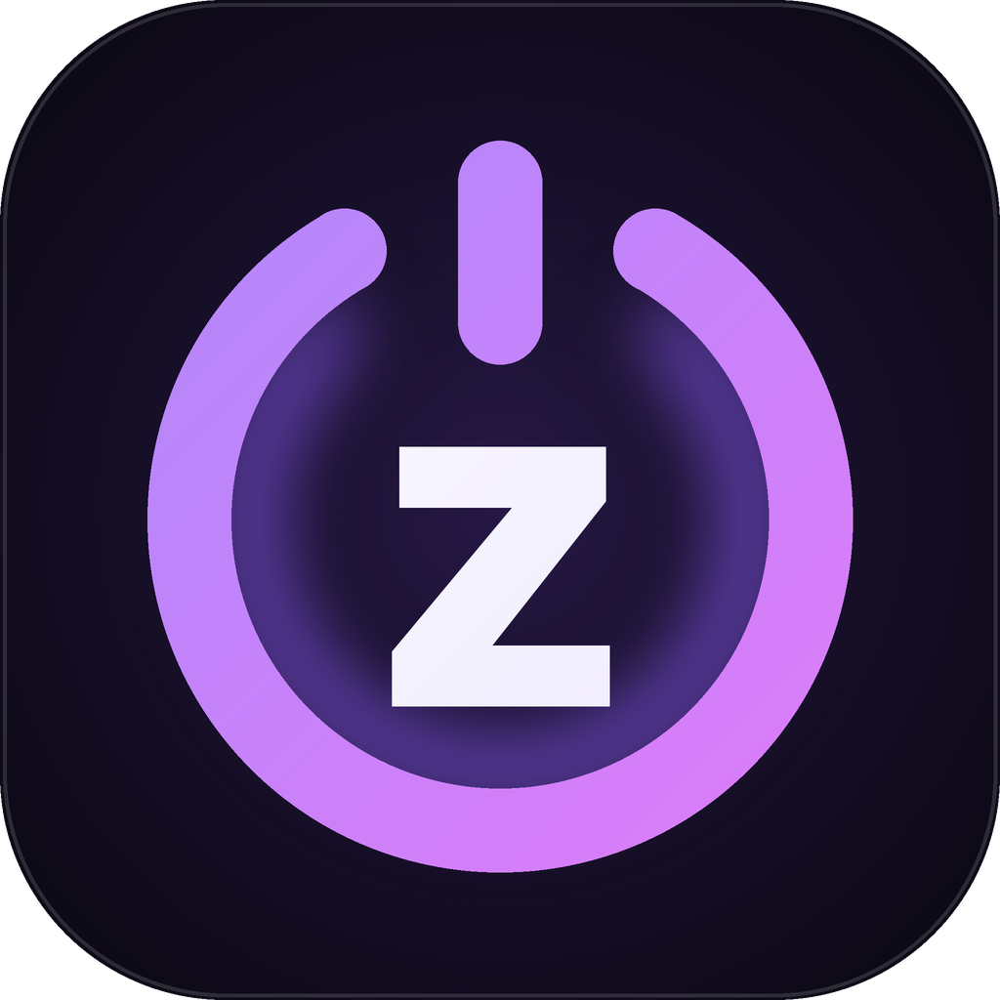

# Zapret OneClick

<p align="center"></p>

Обход блокировок Discord и YouTube **одной кнопкой** + локальный прокси для Telegram — в одном приложении для Windows.

- **Автоподбор стратегии.** Перебирает стратегии из [Flowseal/zapret-discord-youtube](https://github.com/Flowseal/zapret-discord-youtube), проверяет доступность Discord и YouTube и оставляет лучшую.
- **Прокси для Telegram.** Ядро [Flowseal/tg-ws-proxy](https://github.com/Flowseal/tg-ws-proxy) (MTProto → WebSocket, резерв через Cloudflare). Если у вас уже есть настроенный TgWsProxy, берутся его порт и secret.
- **Диагностика.** Вкладка проверяет права администратора, файлы zapret, антивирус (Kaspersky, Defender), драйвер WinDivert, конфликты, VPN и сеть и пишет, что именно мешает. Если `winws.exe` не стартует, причина (код ошибки Windows) видна в журнале.
- **Оформление** в стиле [mqclass/zapret2-gui](https://github.com/mqclass/zapret2-gui): фиолетово-чёрное «стекло», плавные анимации, сглаженная графика (Pillow).

## Использование

1. Скачайте `ZapretOneClick.exe` из [Releases](../../releases) и запустите (нужны права администратора — для WinDivert).
2. Нажмите большую кнопку. При первом запуске приложение скачает zapret (или укажите свою папку в «Настройки»).
3. Для Telegram — вкладка **Telegram → Подключить Telegram**.

Для Discord/YouTube включите Secure DNS в браузере или системе. Если установлена служба `zapret` или запущен TgWsProxy на том же порту — остановите их.

## Сборка из исходников

```powershell
.\build.bat
```

Нужны Python 3.10+ и Windows. Результат: `dist\ZapretOneClick.exe`.

## Структура

| Файл | Назначение |
|---|---|
| `app.py` | интерфейс и анимации |
| `gfx.py` | сглаженная графика (спрайты, свечения, твины) |
| `engine.py` | загрузка zapret, разбор стратегий из `.bat`, автоподбор |
| `diag.py` | диагностика: поиск причины, почему обход не запускается |
| `tgproxy.py` | обёртка над ядром tg-ws-proxy (`proxy/`) |
| `make_icon.py` | генерация иконки |

## Благодарности и лицензии

Основа — проекты [bol-van/zapret](https://github.com/bol-van/zapret), [Flowseal/zapret-discord-youtube](https://github.com/Flowseal/zapret-discord-youtube) и [Flowseal/tg-ws-proxy](https://github.com/Flowseal/tg-ws-proxy) (MIT; лицензия лежит в `proxy/LICENSE-tg-ws-proxy.txt`). Бинарники zapret/WinDivert в репозиторий не входят — загружаются из релиза Flowseal.

Инструмент предназначен для обхода DPI-ограничений на собственном соединении. Используйте в соответствии с законодательством вашей страны.
